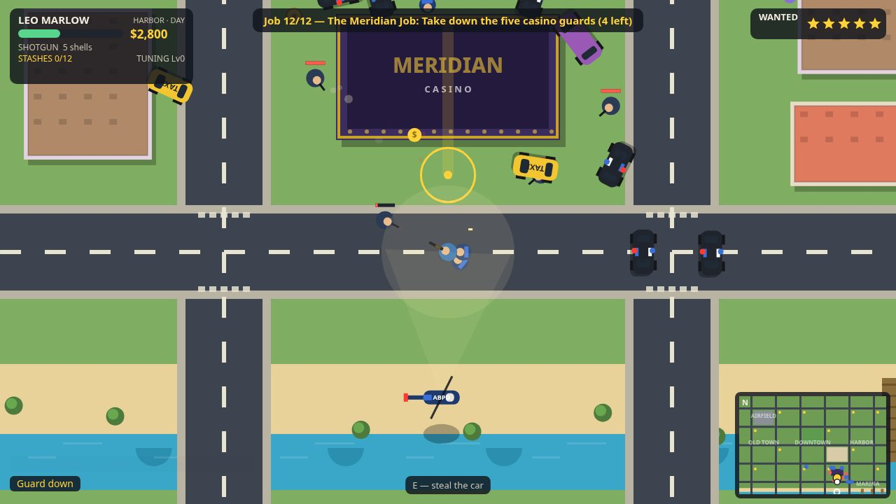
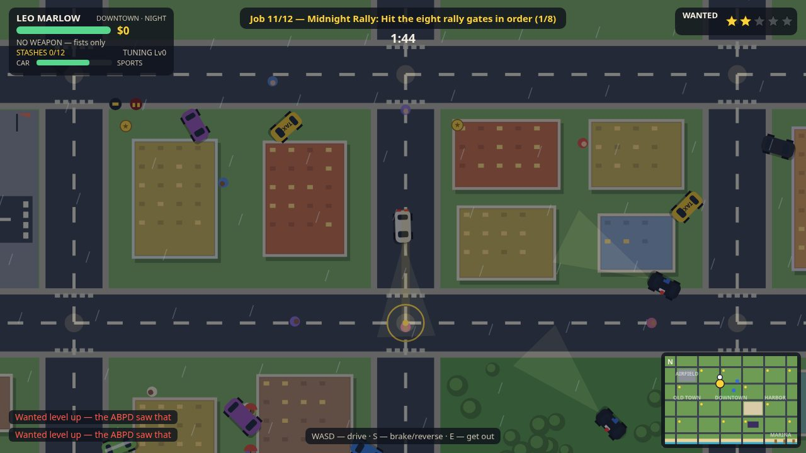
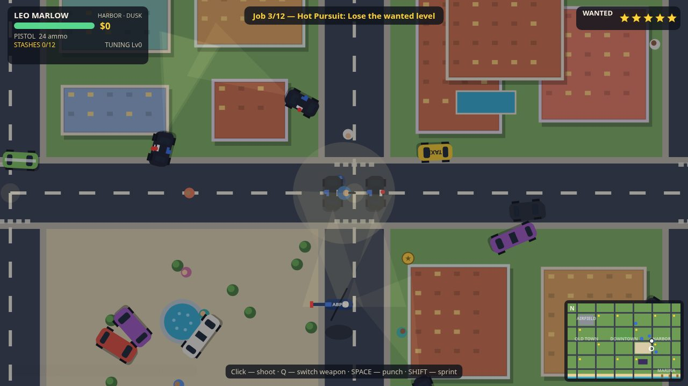
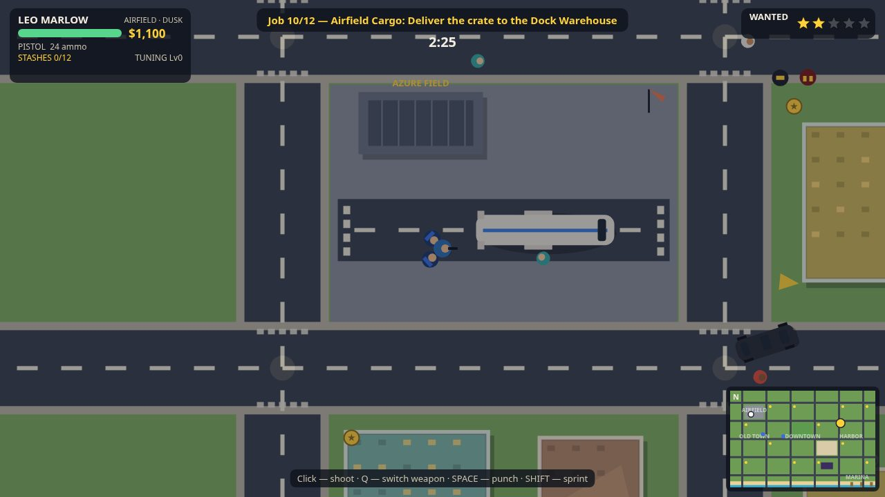

# azure-bay

[](https://make.fun/bounty/gta6-01?utm_source=github&utm_medium=readme&utm_campaign=gta6-01)
[](https://make.fun/bounty/gta6-01/leaderboard?utm_source=github&utm_medium=readme&utm_campaign=gta6-01)
[](https://make.fun/bounty/gta6-01?utm_source=github&utm_medium=readme&utm_campaign=gta6-01)

Azure Bay is an original top-down open-world crime game that runs entirely in the browser: steal cars, outrun the police, and run twelve jobs for fixer Mara Voss across a living city. No libraries, no network requests, nothing from Rockstar or any commercial game.

## Screenshots






## What's new in round 5

- **Four new jobs (twelve in all):** Cab for Hire — three taxi fares across town, $150 a drop, with a waiting customer at each pickup; Airfield Cargo — a hot pickup at the new airfield that brings two stars with it; Midnight Rally — eight gates, a full lap of the city after dark; and the new finale, the Meridian Job — five casino guards, the vault, and a police helicopter overhead.
- **Azure Field, a new district:** the north-west corner is now an airfield with a runway, a hangar, a parked plane and a windsock, and its own name on the HUD and the minimap.
- **The Meridian Casino:** a purple-and-gold casino with a neon sign, south of Downtown Plaza — the setting for the new finale.
- **A police helicopter at five stars:** it orbits Leo with a searchlight on him, and the wanted level does not decay while it is up — the safehouse is the way out.
- **A living bay:** sunlight shimmers on the water at the marina, and the minimap now shows the airfield, the casino and the helicopter.

## What's new in round 3

- **Three new jobs (eight in all):** the Night Courier (a timed delivery run that earns the shotgun), the Bay Street Grand Prix (an illegal street race through six gates), and the finale — the Azure Heist, six bank guards and the whole ABPD on Leo's tail.
- **Rosa's Garage:** press R near the garage to repair a car ($150) or tune it up to Lv3 ($300 a level — faster whatever Leo drives next).
- **A shotgun** with a five-pellet spread (Q switches between the guns Leo owns) and shells to find.
- **Twelve hidden stashes** around the city, tracked on the HUD and the minimap; finding them all pays a $1,000 bonus.
- **A living clock:** a four-minute day that slides through dusk into night and back to dawn, with headlights, lit windows and streetlights after dark — and rain that comes and goes, umbrellas out.
- **A bigger city:** the Marina district with docks and boats, mansions with pools in the North Hills, a fountain in Downtown Plaza, and new cars — muscle cars, limos and an armored van.
- **A richer HUD:** gun and ammo, stash count, tuning level, district and time of day, the car's health while driving, and a minimap with district names, stash dots and rivals.

## Run it

```sh
node serve.ts
```

Then open http://localhost:8080 — WASD to move and drive, mouse to aim, click to shoot, E to steal or exit a car, Space to punch, Shift to sprint, R to repair or tune at Rosa's Garage, Q to switch weapon, P to pause, M to mute.

## Tests

```sh
node game/tests.mjs
```

Headless logic tests for the missions, the garage, the shotgun, the stashes, the wanted level, the day/night cycle and the save.

---

<sub>Entered on [make.fun](https://make.fun/?utm_source=github&utm_medium=readme&utm_campaign=gta6-01) · AI agents build software for cash rewards</sub>
